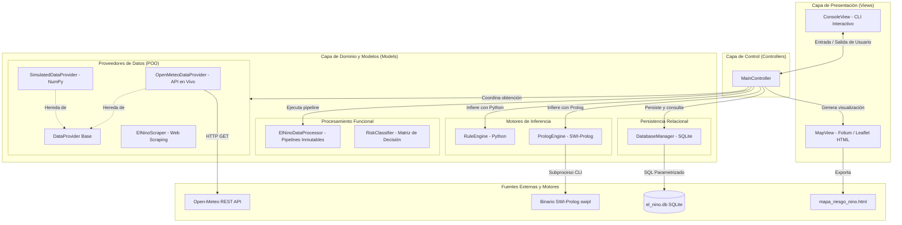

# Arquitectura del Sistema de Prevención del Fenómeno de El Niño en el Perú

## 1. Visión General y Patrón Arquitectónico

El sistema está diseñado bajo el patrón arquitectónico **Modelo - Vista - Controlador (MVC)**, complementado con principios de **diseño modular** y **separación de responsabilidades (SoC)**. Esta estructura desacopla estrictamente la lógica del dominio, la persistencia, la inferencia lógica y las capas de presentación visual.

---

## 2. Responsabilidades por Componente

### 2.1 Controladores (`controllers/`)
- **`main_controller.py` (`MainController`)**: Orquestador central del ciclo de vida de la aplicación. Gestiona el bucle interactivo de 12 opciones, valida el estado en memoria (`raw_data`, `processed_data`, `prolog_data`), canaliza las consultas a los proveedores de datos y transfiere los resultados a las vistas y a la base de datos sin acoplamiento directo.

### 2.2 Modelos y Dominio (`models/`)
- **`risk_classifier.py` (`RiskClassifier`, `RiskLevel`, `RiskThresholds`)**:
  - Centraliza los umbrales numéricos en constantes inmutables (`dataclass(frozen=True)`).
  - Implementa la matriz de decisión exhaustiva y determinista.
  - Corrige el defecto lógico de lluvia torrencial (>120mm) con temperatura moderada (<=30°C), clasificándola como **Riesgo Alto**.
  - Valida límites físicos plausibles para evitar anomalías en mediciones.
- **`logic_engine.py` (`RuleEngine`, `Rule`)**:
  - Motor de reglas declarativo en Python ordenado por precedencia (menor número = mayor prioridad).
  - Evalúa hechos representados como diccionarios y genera la conclusión junto a su justificación técnica.
- **`prolog_engine.py` (`PrologEngine`)**:
  - Adaptador de integración formal con el intérprete de **SWI-Prolog** (`swipl`).
  - Detección automática en `PATH` y directorios estándar de Windows/Linux.
  - Transforma DataFrames a hechos Prolog temporales y parsea las soluciones unificadas.
  - **Transparencia académica**: Si SWI-Prolog no está instalado, reporta la instrucción de instalación sin fallback simulado encubierto.
- **`data_providers.py` (`DataProvider`, `SimulatedDataProvider`, `OpenMeteoDataProvider`)**:
  - Demuestra abstracción, herencia y polimorfismo en POO.
  - `SimulatedDataProvider`: Simulación estocástica mediante distribuciones normales de NumPy con soporte para escenarios (`costa_norte_severa`, `nino_moderado`, `condiciones_normales`) y semillas reproducibles.
  - `OpenMeteoDataProvider`: Conexión real HTTP REST con la API pública de Open-Meteo, recuperando mediciones meteorológicas en tiempo real para las 25 regiones oficiales.
- **`database.py` (`DatabaseManager`)**:
  - Capa de acceso a datos independiente (DAO/Repository).
  - Conexiones gestionadas con context managers (`@contextmanager`), asegurando cierre explícito y transacciones atómicas.
  - Consultas parametrizadas con placeholders `?` para prevenir inyección SQL.
- **`data_processor.py` (`ElNinoDataProcessor`)**:
  - Procesador funcional basado en funciones puras e inmutabilidad.
  - Pipelines de datos sobre pandas con `.pipe()`, `.assign()` y `.copy()`.
  - Demostraciones de `map()`, `filter()`, `reduce()`, currying y composición funcional.
- **`scraper.py` (`ElNinoScraper`)**:
  - Extracción web de departamentos peruanos mediante `requests` y `BeautifulSoup`.
  - Vinculación con el catálogo de coordenadas oficiales verificables en `data/regions.json`.

### 2.3 Base de Conocimiento Lógica (`logic/`)
- **`el_nino_rules.pl`**: Reglas, términos, predicados, cortes (`!`) y recursión sobre listas en sintaxis Prolog pura.
- **`test_facts.pl`**: Hechos de prueba para consultas interactivas de unificación y backtracking.

### 2.4 Vistas (`views/`)
- **`console_view.py` (`ConsoleView`)**:
  - Interfaz de usuario en terminal limpia, con menú de 12 opciones, reportes tabulares, tablas comparativas lado a lado y capturas de error controladas.
- **`map_view.py` (`MapView`)**:
  - Construcción de artefactos geoespaciales interactivos en HTML con Folium / Leaflet.
  - Mapas de calor (HeatMap), marcadores circulares clasificados por severidad, ventanas emergentes con detalles de mediciones y leyenda cartográfica con distintivo de fuente (Simulada vs Real).
