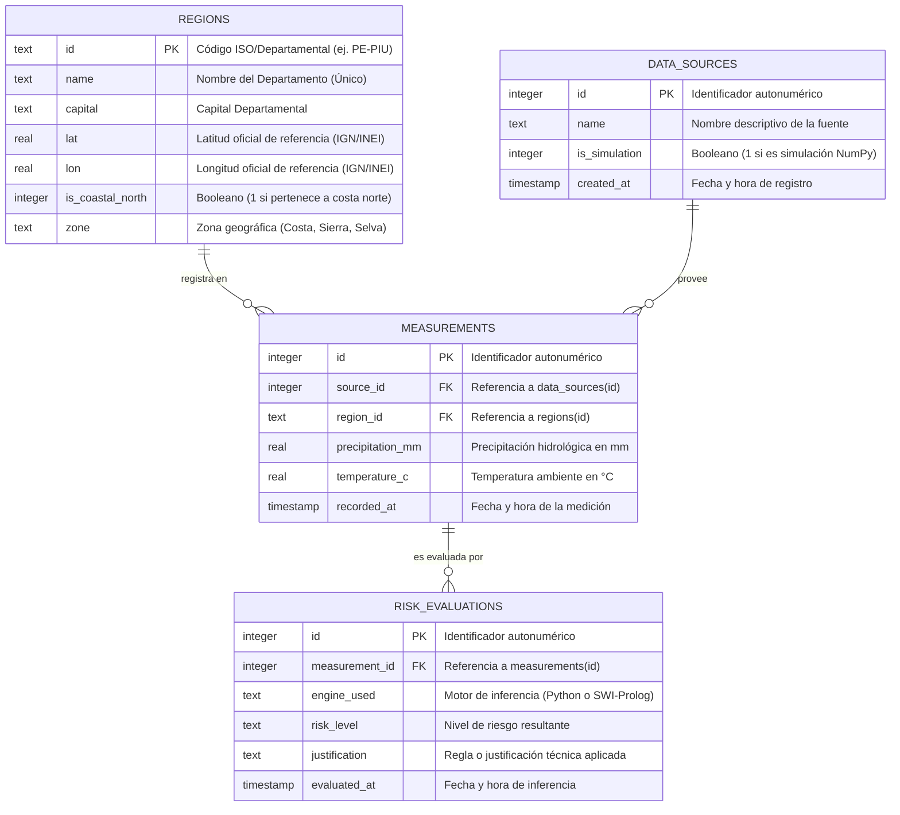

# Diseño y Modelo Relacional de la Base de Datos (SQLite)

## 1. Visión General
La persistencia de datos del sistema está implementada sobre el motor relacional **SQLite 3**, residiendo el archivo físico en `data/database/el_nino.db`.

El esquema fue diseñado bajo la **Tercera Forma Normal (3NF)**, asegurando la integridad referencial mediante claves foráneas activadas (`PRAGMA foreign_keys = ON;`), transaccionalidad atómica y consultas estrictamente parametrizadas.

---

## 2. Diagrama Entidad-Relación (Mermaid)

---

## 3. Diccionario de Datos

### 3.1 Tabla `regions`
Almacena el catálogo fijo de departamentos peruanos con sus coordenadas geográficas reales de referencia.
- **`id` (TEXT, PK):** Identificador unívoco estándar (ej. `'PE-PIU'`, `'PE-TUM'`).
- **`name` (TEXT, NOT NULL, UNIQUE):** Nombre de la región/departamento.
- **`capital` (TEXT):** Ciudad capital departamental.
- **`lat` (REAL, NOT NULL):** Coordenada de latitud en grados decimales.
- **`lon` (REAL, NOT NULL):** Coordenada de longitud en grados decimales.
- **`is_coastal_north` (INTEGER, NOT NULL):** Indicador binario (1 = Tumbes, Piura, Lambayeque, La Libertad; 0 = resto).
- **`zone` (TEXT):** Región natural o zona climática.

### 3.2 Tabla `data_sources`
Registra la trazabilidad de los orígenes de datos empleados durante las sesiones.
- **`id` (INTEGER, PK, AUTOINCREMENT):** Clave primaria.
- **`name` (TEXT, NOT NULL):** Denominación de la fuente (ej. *'Simulación Estocástica NumPy (Escenario: costa_norte_severa)'*, *'Open-Meteo Weather API'*).
- **`is_simulation` (INTEGER, NOT NULL):** Distintivo de auditoría (1 = Datos Sintéticos, 0 = Datos en Vivo).
- **`created_at` (TIMESTAMP):** Fecha y hora de creación del lote.

### 3.3 Tabla `measurements`
Registra las observaciones hidroclimáticas por región y fuente.
- **`id` (INTEGER, PK, AUTOINCREMENT):** Clave primaria.
- **`source_id` (INTEGER, FK):** Referencia a `data_sources(id)` (ON DELETE CASCADE).
- **`region_id` (TEXT, FK):** Referencia a `regions(id)` (ON DELETE CASCADE).
- **`precipitation_mm` (REAL, NOT NULL):** Lluvia acumulada o estimada en milímetros.
- **`temperature_c` (REAL, NOT NULL):** Temperatura en grados Celsius.
- **`recorded_at` (TIMESTAMP):** Estampa temporal del registro.

### 3.4 Tabla `risk_evaluations`
Almacena las deducciones e inferencias generadas por los motores lógicos.
- **`id` (INTEGER, PK, AUTOINCREMENT):** Clave primaria.
- **`measurement_id` (INTEGER, FK):** Referencia a la medición analizada (ON DELETE CASCADE).
- **`engine_used` (TEXT, NOT NULL):** Motor ejecutor (*'Python RuleEngine'* o *'SWI-Prolog'*).
- **`risk_level` (TEXT, NOT NULL):** Categoría deducida (*'Riesgo de Inundacion Extremo'*, *'Riesgo de Inundacion Alto'*, etc.).
- **`justification` (TEXT):** Descripción de la premisa lógica activada.
- **`evaluated_at` (TIMESTAMP):** Estampa temporal de la inferencia.

---

## 4. Estrategia de Acceso y Buenas Prácticas
1. **Separación de Capas:** El módulo `models/database.py` encapsula la totalidad de sentencias DDL y DML. Ninguna vista ni controlador interactúa directamente con SQL.
2. **Context Managers (`@contextmanager`):** Garantizan la apertura, commit, rollback automático ante excepciones y el cierre explícito de la conexión SQLite (`finally: conn.close()`), evitando bloqueos de archivos en sistemas Windows.
3. **Parametrización:** Las sentencias emplean placeholders `?` en todas las inserciones y cláusulas `WHERE`, eliminando vulnerabilidades de inyección SQL.
